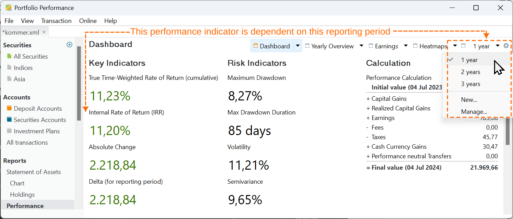
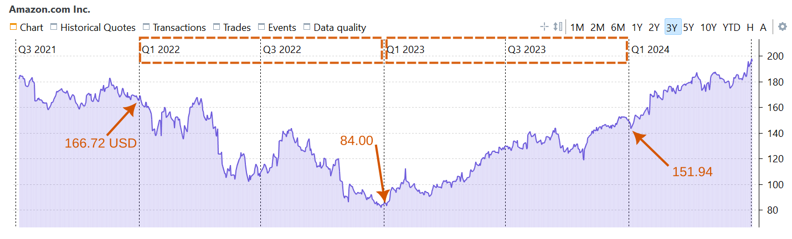
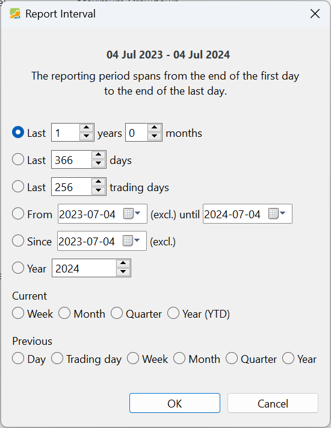

Der Berichtszeitraum bezieht sich auf den spezifischen Zeitraum, der bei der Berichterstattung über die Performance Ihres Portfolios verwendet wird. Zum Beispiel werden die in Abbildung 1 dargestellten Performance-Kennzahlen über einen einjährigen Zeitraum berechnet, beginnend ab dem heutigen Datum. Andere Berichte und Diagramme, wie zum Beispiel solche bezüglich Rendite/Varianz und Sicherheitsleistung, berücksichtigen ebenfalls diesen Berichtszeitraum. Es ist entscheidend zu verstehen, dass *jede* Performance-Berechnung auf einem Berichtszeitraum basiert, selbst wenn dieser nicht explizit definiert wurde. Standardmäßig ist er in Portfolio Performance auf ein Jahr ab dem heutigen Datum eingestellt.

Abbildung: Dropdown-Liste zur Auswahl des Berichtszeitraums. {class=pp-figure}

Der Berichtszeitraum kann die Performance erheblich beeinflussen und lässt sich leicht manipulieren, um eine bestimmte Sichtweise zu unterstützen. Schau dir zum Beispiel den Preistrend der Amazon-Aktie, wie in Abbildung 2 dargestellt. Je nach Berichtszeitraum haben Sie entweder einen massiven Verlust, einen massiven Gewinn oder einen moderaten Verlust.

!!! Hinweis
    Verwenden Sie die Gleichungen unter [Grundlagen > Performance](./performance/index.md), um die Performance-Kennzahlen zu berechnen. Wenn du die Zahlen in PP überprüfen möchten, verwende das Kommer-Portfolio. Füge Amazon als [Benchmark](../referenzhandbuch/ansichten/berichte/performance/performance-diagramm.md) zum Performance-Diagramm hinzu und stelle den entsprechenden Berichtszeitraum ein, z.B. 2022. Vergiss nicht, die Portfolio-Währung auf USD zu ändern, um die Performance-Berechnungen in USD durchzuführen.

- 2022: `TTWROR = IRR = (84/166,72)-1 = -49,62%`
- 2023: `TTWROR = IRR = (151,94/84)-1 = +80,88%`
- 2022-2023: `TTWROR = IRR = (151,94/166,72)-1 = -8,87% oder -4,53% p.a.`

Abbildung: Historische Kurse in USD für Amazon (Zeitraum 2022 - 2023). {class=pp-figure}

Du kannst den Berichtszeitraum mit dem Dropdown Zeitraum:material-triangle-small-down: in der oberen rechten Ecke des Fensters einstellen (siehe Abbildung 1). Die verfügbaren Optionen sind: `1 Jahr`, `2 Jahre`, `3 Jahre`, `Neu ...` und `Verwalten ...`. Mit dieser letzten Option kannst du die verfügbaren Zeiträume löschen oder neu anordnen.

Der Zeitraum von 1, 2 oder 3 Jahren wird immer vom heutigen Tag berechnet und erstreckt sich vom Ende des heutigen Tages bis zum Ende des Tages vor einem, zwei oder drei Jahren. Wenn heute der 4. Juli 2024 ist, dann erstreckt sich ein Berichtszeitraum von 1 Jahr vom Schlusszeitpunkt des 4. Juli 2023 bis zum Schlusszeitpunkt des 4. Juli 2024. Der Marktwert zu Beginn (MVB) dieses Zeitraums spiegelt den Status des Portfolios am Ende des 4. Juli 2023 wider, während MVE den Status des Portfolios am Ende des 4. Juli 2024 darstellt (siehe zum Beispiel Abbildung 3). In Bezug auf die [IRR-Berechnungsgleichung](performance/geld-gewichtet.md) sollten Transaktionen, die am ersten Datum erfolgen, z.B. am 4. Juli 2023, nicht in die Gleichung einbezogen werden, da sie bereits in der MVB des Zeitraums berücksichtigt sind. Umgekehrt sollten Transaktionen am letzten Tag des Zeitraums in die Gleichung einbezogen werden, da sie die MVE beeinflussen, selbst wenn für einen sehr kurzen Zeitraum. In dem oben erwähnten Beispiel erstreckt sich der Zeitraum `Jahr 2022` vom 31. Dezember 2021 bis zum 31. Dezember 2022, weshalb ein Kauf am 1. Januar 2022 als Cashzufluss betrachtet werden sollte.

Mit dem Untermenü `Neu` kannst du benutzerdefinierte Zeiträume erstellen. Die Auswahlmöglichkeiten in Abbildung 3 sind ziemlich selbsterklärend. Du kannst diesem Zeitraum keinen benutzerdefinierten Namen geben, da sie vordefiniert und von PP benannt werden: zum Beispiel `Letzte 10 Handelstage` oder `2023` für das Jahr 2023.

Abbildung: Mögliche benutzerdefinierte Zeiträume für Berichte (der aktuelle Tag ist der 4. Juli 2024). {class=pp-figure}

- `Letzte xxx Jahre yyyy Monate`: Von dem aktuellen Tag minus der Anzahl der Jahre und Monate. Die Standardzeiträume von `1 Jahr`, `2 Jahre`, `3 Jahre` könnten mit dieser Option neu erstellt werden. Mit dieser Syntax kannst du jedoch auch einen benutzerdefinierten Zeitraum erstellen, wie z.B. einen `1,5 Jahren` Zeitraum.
- `Letzte xxx Tage`: Ein Tag bezieht sich auf einen Kalendertag. Beachte, dass in Abbildung 3 die letzten xxx Tage bereits vorausgefüllt sind. Portfolio Performance erkennt, dass das aktuelle Jahr 2024 ein Schaltjahr mit dem 29. Februar ist und setzt daher automatisch die Anzahl der Tage auf 366.
- `Letzte xxx Handelstage`: Ein Handelstag bezieht sich auf einen regulären Geschäftstag, an dem die Finanzmärkte für den Handel geöffnet sind. Wochenenden und Tage aus dem [ausgewählten Kalender](../referenzhandbuch/hilfe/einstellungen.md#kalender) werden ausgeschlossen. Der zu verwendende Kalender kann im Menü `Hilfe > Einstellungen > Kalender` festgelegt werden. Gibt es 256 Handelstage in 2024? In Abbildung 3 wurde der `Standard`-Kalender ausgewählt, der sieben Feiertage enthält: Neujahr, Ostermontag, Heiligabend und vier weitere. In dem ausgewählten Zeitraum gibt es 262 nicht-Wochenende-Tage. Von den sieben Feiertagen fallen sechs (außer Heiligabend 2023) auf einen Wochentag. Somit gibt es insgesamt 256 Handelstage im Jahr.
- `Von xxx (exkl.) bis yyy`: Ein Zeitraum zwischen zwei Daten, wobei der erste Tag nicht eingeschlossen ist (beginnt am Ende dieses Tages).
- `Seit xxx (exkl)`: Von dem angegebenen Datum (ausgeschlossen) bis heute (eingeschlossen).
- `Jahr xxxx`: Das Jahr läuft immer vom 31. Dezember xxxx bis zum 31. Dezember xxxx+1.
- `Aktuell`: `Woche`, `Monat`, `Quartal` oder `Jahr`. Eine Woche läuft vom Sonntag oder Montag (Abend) bis zum folgenden Sonntag oder Montag (Abend), abhängig vom in den [Einstellungen](../referenzhandbuch/hilfe/einstellungen.md#sprache) angegebenen Land. Ein Quartal umfasst drei Monate, z.B. Januar bis März, April bis Juni und so weiter. Die Abkürzung `YTD` steht für *Year-to-date* und bezieht sich auf den Zeitraum vom Beginn des aktuellen Jahres bis zum heutigen Tag.
- `Vorherige`: `Tag`, `Handelstag`, `Woche`, `Monat`, `Quartal` und `Jahr`. Der `Vorherige Tag` ist nicht dasselbe wie die `Letzten 1 Tage`. Bis heute, dem 4. Juli, wäre der Vorherige Tag der 3. Juli, der vom Abend des 2. Juli bis zum Abend des 3. Juli läuft, während der Zeitraum der `Letzten 1 Tag` den 4. Juli (den aktuellen Tag) umfasst. Der Vorherige Handelstag ist ähnlich dem Vorherigen Tag, aber ohne Wochenenden und Feiertage. Der Vorherige Monat läuft vom ersten Tag des vorherigen Monats bis zum letzten Tag des aktuellen Monats. Das erste Quartal läuft vom 1. Januar bis zum 31. März. Das Vorherige Jahr beginnt am 1. Januar des vorherigen Jahres und endet am 31. Dezember des vorherigen Jahres.

