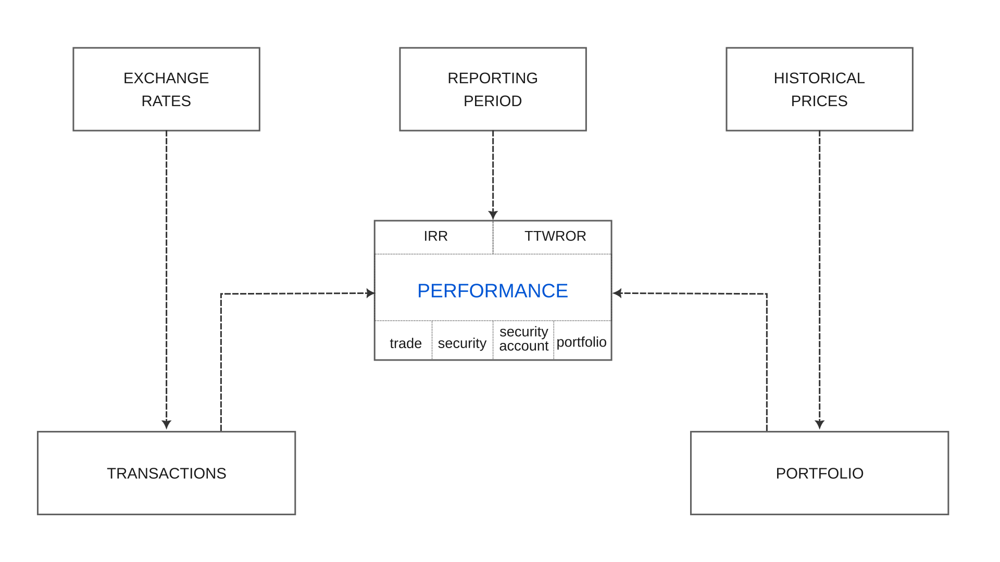

Der Name PortfolioPerformance (PP) bringt es auf den Punkt. Das Programm analysiert Portfolios unter dem Gesichtspunkt der Performance. Dieser Schwerpunkt steht im Gegensatz zu vielen proprietären Broker-Apps, die in erster Linie die technische Ausführung von Aufträgen erleichtern. Im folgenden Text werden die wichtigsten Komponenten beschrieben (siehe Abbildung 1). Weitere Informationen zu den einzelnen Komponenten findest Du, über die einzelnen Links. [Hier]findest Du ein einfaches Beispiel mit einem leicht nachvollziehbaren Portfolio.

## Komponenten

Abbildung: Systemübersicht incl. aller Komponenten und Beziehungen zueinander.{class=pp-figure}

Performance ist ein mehrschichtiges Konzept. Es gibt nicht nur verschiedene Methoden zur Berechnung, wie zum Beispiel [money-weighted (IRR)](./performance/money-weighted.md) und [time-weighted (TTWROR)](./performance/time-weighted.md) Renditen, sondern kann auch auf verschiedenen Ebenen berechnet werden: Das [Portfolio als Ganzes](../reference/view/reports/performance/index.md), ein Wertpapiers- oder Einzahlungskonto, eine [einzelne Wertpapier](../reference/view/reports/performance/securities.md) oder ein einzelner [Handel](../reference/view/reports/performance/trades.md). In seiner einfachsten Form, ohne Transaktionen, kann die Performance eines Portfolios durch die folgende Gleichung dargestellt werden (bitte beachte die Links oben für weitere detaillierte Informationen):

$$\mathrm{r = \frac{(MVE - MVB)}{MVB} \quad (Eq  1)}$$

wobei MVE = der Marktwert des Portfolios am Ende des Berichtszeitraums und MVB = der Marktwert des Portfolios am Anfang des Zeitraums.

Die Performance wird direkt durch den [Berichtszeitraum](./reporting-period.md) beeinflusst, der standardmäßig auf ein Jahr ab heute eingestellt ist. Der Berichtszeitraum bestimmt den Wert des Portfolios, Kontos oder der Wertpapier zu Beginn und Ende des Zeitraums (z.B. MVB und MVE in den Performance-Gleichungen). Bei der money-weighted Rendite (IRR) beeinflusst er auch die verbleibende Dauer, die ein Cashflow zur Erzielung eines Gewinns oder Verlusts am Ende des Berichtszeitraums hat.

[Währungskurse](../reference/view/general-data/currencies.md) haben einen indirekten Einfluss und spielen eine Rolle, wenn eine Transaktion eine Währungsumrechnung erfordert. Das schließt Überweisungen zwischen verschiedenen Währungskonten und Transaktionen wie Käufe, Verkäufe und Dividenden in mehreren Währungen ein. Zum Beispiel kann der Kauf von Wertpapieren, die in USD kursieren, eine Umrechnung von Euro in USD erfordern. Beim Verkauf dieser Wertpapiere müssen Sie die USD wieder in Euro umrechnen. Schwankungen des Währungskurses zwischen Kauf- und Verkaufszeitpunkt können zu Gewinnen oder Verlusten führen, da der Wert der USD in Euro sich geändert haben kann.

[Historische Kurse](../how-to/downloading-historical-prices/index.md) von Wertpapieren beeinflussen erheblich den Marktwert und damit die Performance des Portfolios, Wertpapierskonten, einzelner Wertpapieren und Handelsgeschäfte. Es ist klar, dass ein Wertpapier, dessen Preis am Ende eines Handels höher ist als zu Beginn, einen profitablen Handel ergeben hat. Dieser Preisanstieg führt zu einem Kapitalgewinn, der direkt zur Gesamtperformance und zum Wert des Portfolios beiträgt.

Zu guter Letzt: Performance hängt direkt vom Portfolio und Transaktionen ab. *Ohne* Transaktionen innerhalb des Berichtszeitraums vereinfacht sich die grundlegende Performance-Gleichung zu IRR = TTWROR = (MVE/MVB) - 1. Wenn MVE größer als MVB ist, wurde ein Gewinn erzielt, was zu einer positiven Performance führt. Umgekehrt, wenn MVE kleiner als MVB ist, ist das Portfolio am Ende des Berichtszeitraums weniger wert als zu Beginn, was zu einer negativen Performance führt.

## Transaktionen

Dinge werden komplizierter, wenn [Transaktionen](../reference/transaction/index.md) während des Berichtszeitraums auftreten. Es gibt 13 Arten von Transaktionen, jede generiert Cashflows in und aus dem Portfolio, Konto oder einem Wertpapier. Abbildung 2 zeigt alle Transaktionstypen zwischen den vier Hauptkomponenten: das Portfolio (dargestellt durch eine gestrichelte blaue Linie), Einzahlungskonten in EUR und USD, drei Wertpapieren (von denen zwei in USD kursieren) und zusammengefasst in zwei Depots (orangefarbene und blaue gestrichelte Linien). Wertpapier-2 (USD) ist in beiden Konten vorhanden.

Transaktionen werden durch Pfeile dargestellt. Sie erzeugen Cash-Outflows (rote Kreise) oder Cash-Inflows (grüne Kreise). Die Zahlen neben den Kreisen repräsentieren die Größe des Cashflows, basierend auf einem hypothetischen Beispiel eines Kaufs oder Verkaufs von 5 Aktien zu 10 EUR/USD pro Aktie, was zu einem Kapitalzufluss von 50 EUR/USD führt. Gebühren und Steuern sind jeweils auf 1 und 2 EUR eingestellt. Eine Dividende von 2 USD pro Aktie wird gezahlt; ein Wechselkurs von 0,9 EUR/USD wird verwendet.

Abbildung: Übersicht aller Transaktionstypen mit zugehörigen Cashflows auf Portfolio-, Konto- und Wertpapierebene. {class=pp-figure}

Wie zu sehen ist, **erzeugen nur vier Arten von Transaktionen** einen Cashflow auf der Portfolioebene: Einzahlung, Entnahme (Abhebung), Einlieferung und Auslieferung. Diese Transaktionen beeinflussen also den Performance-Indikator im Dashboard (Ansicht > Berichte > Performance); welcher ein Portfolio-Performance-Indikator ist.

Eine [*Einzahlung*](../reference/transaction/deposit-removal.md)-Transaktion erzeugt zwei Cashflows: einen auf der Portfolioebene und einen auf der Einzahlungskontoebene. Diese Transaktion führt zu einem Zufluss, da Geld in das Einzahlungskonto gebracht wird, und somit auch in das Portfolio. Andererseits erzeugt eine [*Abhebung*](../reference/transaction/deposit-removal.md) zwei Cashflows und entfernt Geld von einem Bargeldkonto und dem Portfolio.

Eine [*Einlieferung*](../reference/transaction/delivery.md) fügt Aktien zu Depot hinzu; somit erhöht sie das Kapital der Aktie (Aktien x historischer Preis) **und** des Depots. Umgekehrt verringert eine [*Auslieferung*](../reference/transaction/delivery.md) das Kapital, indem Aktien aus dem Depot entfernt werden, was zu einem Cashflow führt.

Besondere Aufmerksamkeit sollte auf [*Gebühren* und *Steuern*](../reference/transaction/fees-taxes.md) gelegt werden. Die Einlieferung von 5 Aktien zu je 10 EUR pro Aktie erhöht das Kapital um 50 EUR, benötigt aber einen 53 EUR Zufluss in das Portfolio. Jedoch ist der Cashflow in das Wertpapier 51 EUR, da die 1 EUR Gebühr erst nach dem Cashflow an der Wertpapiergrenze abgetrennt wird. Um den Cashflow eines Wertpapier zu bestimmen, sollte man immer die Gebühren berücksichtigen. Gebühren gelten als inhärent zur Transaktion, während Steuern nicht inhärent zu einem Wertpapier gelten. Die Sammlung von Steuern variiert stark pro Land, und die Performance einer Wertpapier sollte davon nicht abhängen. Steuern sind standardmäßig von der Performanceberechnung auf Wertpapierebene ausgeschlossen. In Bezug auf die Wertpapierkontoebene bietet PP zwei Möglichkeiten: Kontoperformance **vor** oder **nach** Steuern (Standardberechnung); siehe Menü Ansicht > Berichte > Diagramm > Diagramm konfigurieren > Datenreihe hinzufügen ... Die Standard **Nach Steuern** Berechnung ist in Abbildung 2 dargestellt. Beim Überschreiten der Wertpapierskontogrenze (zweiter grüner Kreis) sind die Steuern bereits im Steuerbestandteil des Wertpapier berücksichtigt. Der Cashflow des Wertpapierskontos beträgt also 51 EUR. Bei der **Vor Steuern** Berechnung ist der Cashflow des Wertpapierskontos 53 EUR, weil 2 EUR Steuern nur nach dem Überschreiten der Wertpapierskontogrenze in die Steuerentität eingezahlt werden.

Alle anderen Transaktionen sind intern für das Portfolio; sie beeinflussen nicht die Performance des Portfolios. Zum Beispiel hat die *Auslieferung* einen Fluss zwischen zwei Einzahlungskonten und hat somit keinen Einfluss auf die Performance des Portfolios, außer wenn eine Währungsumrechnung wie im Beispiel von Abbildung 2 vorliegt.

Angenommen, Sie überweisen 100 EUR am Anfang des Berichtszeitraums zu einem Umrechnungskurs von 1,1 EUR/USD, was zu einem Einzahlungsbetrag von 90,91 USD wird. Der Wechselkurs ändert sich zum Ende des Berichtszeitraums auf 0,9 EUR/USD. Da die Performanceberechnung in der Währung des Portfolios erfolgt, z.B. EUR, beträgt der Betrag von 90,91 USD am Periodenende 81,82 EUR, was einem Verlust von etwa 18 EUR aufgrund der Währungsverlust führt.

Eine [*Kauf*](../reference/transaction/buy-sell.md)-Transaktion ähnelt eng einer Einlieferung, außer dass der Cashflow aus dem Portfolio herauskommt, anstatt von außen. Aus Sicht des Bargeldkontos ähnelt dies einem Cashflow. Die Wertpapier und das Wertpapierskonto erhalten einen Cashzufluss. Für eine Diskussion über Gebühren und Steuern siehe den vorherigen Text.

Ein *Verkauf* führt zu einem Cashzufluss in ein Einzahlungskonto (47 USD), da der 50 USD Kapitalverkauf durch Steuern und Gebühren reduziert wird.

!!! Hinweis
    In Bezug auf die Performance kann eine Kauft/Verkauf- versus Einlieferung/Auslieferung erhebliche unterschiedliche Ergebnisse liefern. Nur wenn ein Kauftransaktion begleitet wird von einer Einzahlungstransaktion am gleichen Tag und in gleicher Höhe, gibt es keinen Unterschied in der Performance zwischen Kauf und Einlieferung. Wenn jedoch eine Kauftransaktion nicht von einer entsprechenden Einzahlungstransaktion begleitet wird, wird der Cash-Bestand im zugehörigen Konto reduziert (und potenziell negativ), was einen negativen Einfluss auf den Marktwert am Ende (MVE) des Kontos haben kann.

Eine [*Dividende*](../reference/transaction/dividend.md) kann als eine Art Verkaufstransaktion betrachtet werden. In Abbildung 2 wird das Kapital (5 Aktien) von Wertpapier-2 (USD) eine Dividende (Bruttobetrag) von 10 USD (5 Aktien x 2 USD/Aktie) ausschütten. Die Gebühren werden abgezogen, was zu einem Cashflow von 9 USD aus dem Wertpapier und dem Wertpapierskonto führt. Nach Abzug der Steuern und Umrechnung der verbleibenden 7 USD in EUR werden 6,3 EUR Cashzufluss auf das Einzahlungskonto-1 (EUR) gebucht.

Die separaten *Gebühren*, *Rückerstattung von Gebühren*, *Steuern* und *Rückerstattung von Steuern* Transaktionen folgen denselben Regeln wie oben beschrieben. Daher macht es keinen Unterschied, ob Sie Steuern und Gebühren als Teil einer Kauf-, Verkaufs- oder Ein/Auslieferung pflegen oder diese in eine separate Transaktion aufteilen.

Ein Sonderfall stellen die *Zinsen* und *Zinsbelastungen* dar. Obwohl sie den Cash-Bestand des Einzahlungskontos erhöhen oder verringern, erzeugen sie **keinen** Cashflow. Genauso wie das Kapital eines Wertpapiers durch wechselnde Kurse steigen oder sinken kann (Kapitalgewinn oder Verlust), kann sich der Bestand eines Einzahlungskontos durch Zinsen ändern.

