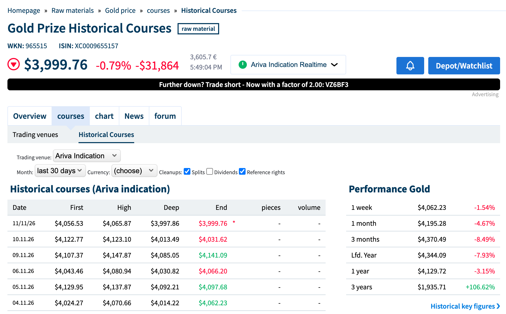
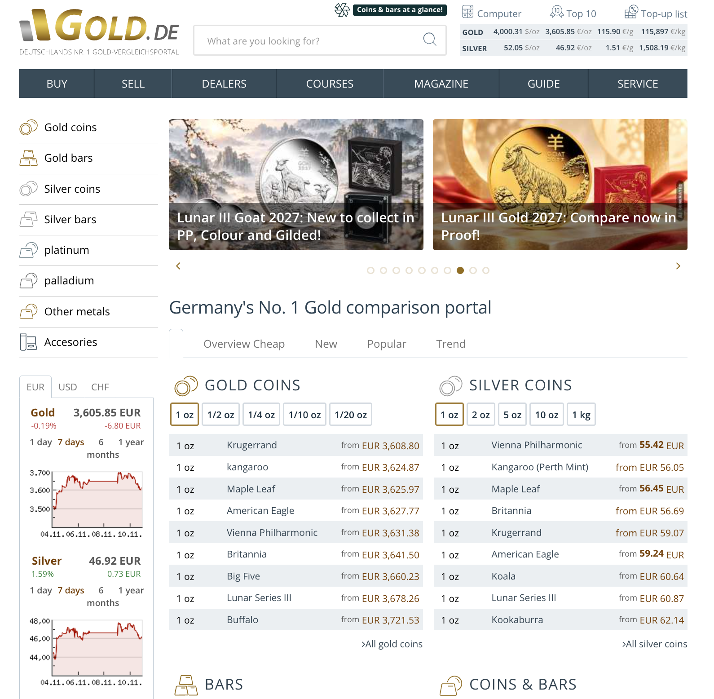
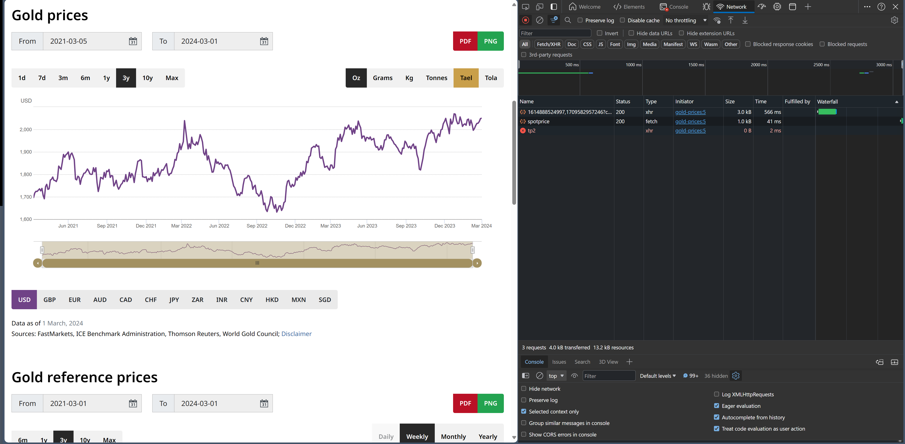
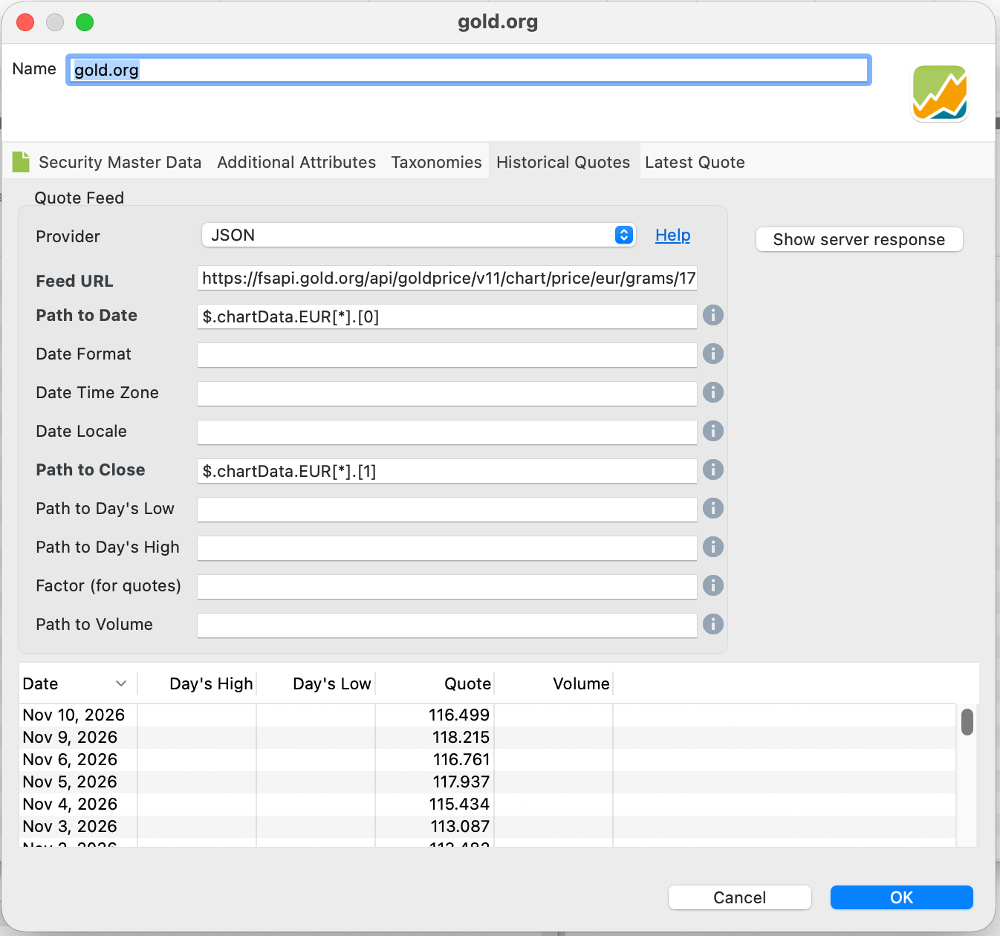
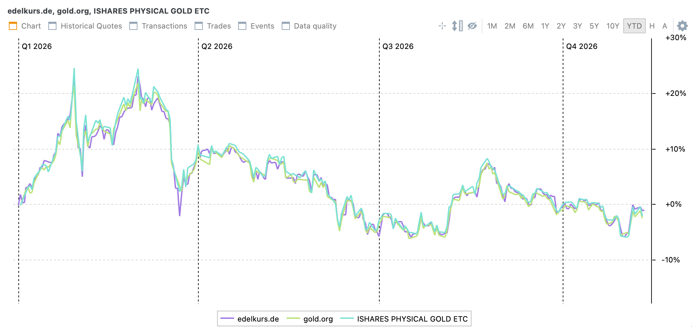

Investing in gold is often chosen in times of economic uncertainty. There are multiple ways to gain exposure to gold. One popular method is investing in physical gold, which involves purchasing gold bullion, coins, or jewelry. Another approach is investing in gold exchange-traded funds (ETFs) or gold trackers, such as [Invesco Physical Gold](https://www.invesco.com/uk/en/financial-products/etfs/invesco-physical-gold-etc.html). These financial instruments aim to replicate the performance of the gold price by holding physical gold in a secure vault. A third but indirect method of investing in gold is by purchasing shares of gold mining companies. Gold miners engage in the exploration, extraction, and production of gold, and their stock prices can be influenced by the price of gold.

Investing in gold through ETFs and gold mining company shares can be handled similarly to regular stocks like Apple Inc., offering ease of access, liquidity, and potential income. While physical gold differs from traditional stocks in several aspects (e.g. gold does not provide ownership in a company or entitle the holder to dividends), it can still be considered an investment that can be bought, sold, and managed as part of a well-diversified portfolio. Therefore, it can be handled in Portfolio Performance as a regular security.

The Portfolio Performance forum has a thread [Wo kann ich aktuelle und historische Gold- und Silberkurse laden?](https://forum.portfolio-performance.info/t/wo-kann-ich-aktuelle-und-historische-gold-und-silberkurse-laden/14/49). This section provides a summary and expands upon the information discussed in the thread.

## Website Ariva.de

The `ariva.de` website has a specific page for [commodities](https://www.ariva.de/rohstoffe/) such as gold, silver, and others. Downloading the latest gold price is as easy as setting the [Quote Feed to a webpage](./downloading-historical-prices/table-website.md) `https://www.ariva.de/gold-kurs/kurse/historische-kurse`. Unfortunately, this method only provides data for the last 30 days. As time progresses, the data will be updated for future days with this method, gradually accumulating several months of gold price history.

Figure: Ariva.de website (translated) with historical gold prices. {class=pp-figure}



You can also replace the Quote Feed URL by one of the previous months (e.g. `https://www.ariva.de/gold-kurs/kurse/historische-kurse?go=1&boerse_id=172&month=2026-10-11`). When importing the data, Portfolio Performance will ask if you want to keep the existing historical prices. By choosing to keep the previous data, you can maintain a continuous record of gold prices for all the months you have downloaded.

But, perhaps the better method is to use a dynamic data URL. Replace the `month=2026-10-11` in the URL from above with the macro version `month={DATE:yyyy-MM-32}`. This macro will iterate through all previous months (going back to 2003) and send a request for each month until there is no data available. If you start from scratch, this process can take some time and will put a significant load on the ariva.de web server.

Another option to obtain historical gold prices is to register for a free account. Then you can download the historical prices as a CSV file, which can be [imported](../reference/file/import/csv-import.md#importing-a-csv-file) into Portfolio Performance (PP).

## London Bullion Market Association (LBMA)

The [London Bullion Market Association](https://www.lbma.org.uk/prices-and-data/precious-metal-prices#/table) is the trade association of the London bullion market — the world's largest and most significant market for trading gold and silver. You can retrieve the prices for gold, silver, platinum, and palladium per year, going back to 1968, in USD, GBP, and EUR. There are two auctions per day (AM and PM). The data can be displayed as a graph or table per year.

Unfortunately, these tables can no longer be accessed without a license key. The graphs (3m, 6m, YTD, All) are just pre-made images (png), and cannot be used inside of the Portfolio Performance app.

## Website EdelKurs

Most price quotes represent the price at which dealers *sell* precious metals. The [EdelKurs](https://edelkurs.de) website (a project by a Portfolio Performance forum user) takes the opposite approach: every day at noon it collects the *purchase prices* (German: `Ankaufspreise`) — the price a dealer would actually pay you — from several well-known precious metals dealers in EUR. If you invest in physical coins and bars, this is the value you would realize when selling, making it a more realistic quote than the spot price.

EdelKurs data has been collected daily since February 2019 (older data going back to 2006 is based on selling prices). The collection runs fully automatically and covers gold, silver, platinum, and palladium, both bars and popular coins such as the Krügerrand, Maple Leaf, Wiener Philharmoniker, and the 100 g gold bar.

The easiest way to use it is through the Portfolio Performance search itself. Simply search for `Krügerrand` when adding a new instrument. The matching EdelKurs configuration appears in the results, and the JSON quote feed settings are applied automatically.

Alternatively, you can set up the [JSON Quote Feed](./downloading-historical-prices/json.md) manually with the following parameters:

- Feed URL: `https://edelkurs.de/Kursdaten/Gold_Kruger.json`
- Path to Date: `$[*].datum`
- Path to Close: `$[*].kurs`

The `datum` entries are summarized per day (e.g. 2026-11-10) with the corresponding purchase price in EUR (e.g. 3612.20) for a Krügerrand of 1 oz. For other products, simply replace the file name in the URL, e.g. `Gold_Barren.json` (gold bar 100 g), `Gold_Maple.json` (Maple Leaf 1 oz), `Gold_WienPhil.json` (Wiener Philharmoniker 1 oz), `Silber_Barren.json` (silver bar 1000 g), `Silber_Kruger.json` (silver Krügerrand 1 oz), `Silber_Maple.json` (silver Maple Leaf 1 oz), `Platin_Barren.json` (platinum bar 100 g), `Platin_Munze.json` (platinum coin 1 oz), `Palladium_Barren.json` (palladium bar 100 g) or `Palladium_Munze.json` (palladium coin 1 oz). If you own e.g. a 10 g gold bar instead of the 100 g bar, you can apply a factor (e.g. `0.1`) in the quote feed settings to convert the price accordingly.

## Website Gold.de

The German website [gold.de](https://www.gold.de/) publishes daily reference prices for all four precious metals: gold, silver, platinum, and palladium. The prices are quoted in EUR and USD, per gram, per troy ounce, or per kilogram, and the history goes back about ten years. Similar to the [gold.org](#website-goldorg) prices, they closely track the international market price (based on the London Bullion Market), but they are not identical to the official LBMA benchmark price.

Figure: Gold.de website (translated) with historical gold prices. {class=pp-figure}



The charts on the [Gold](https://www.gold.de/kurse/goldpreis/), [Silver](https://www.gold.de/kurse/silberpreis/), [Platin](https://www.gold.de/kurse/platinpreis/), and [Palladium](https://www.gold.de/kurse/palladiumpreis/) pages are powered by a small JSON API. For example, the following URL returns the gold price in EUR per troy ounce over the last year:

`https://www.gold.de/api/index.php?cur=e&em=g&zr=1j&stkl=oz&from=&to=&func=emk`

The response is a simple list of `[timestamp, price]` pairs, where the timestamp is expressed in Unix milliseconds, which Portfolio Performance can work with natively.

```json
[
[1767318000000, 4352.95],
[1767404400000, 4364.9],
[1767490800000, 4381.25],
...
]
```
Set up the [JSON Quote Feed](./downloading-historical-prices/json.md) with the following parameters:

- Feed URL: `https://www.gold.de/api/index.php?cur=e&em=g&zr=1j&stkl=oz&from=&to=&func=emk`
- Path to Date: `$[*][0]`
- Path to Close: `$[*][1]`

The URL parameters can be adjusted to your needs:

- `em=g` (gold), `em=s` (silver), `em=pl` (platinum) or `em=pa` (palladium)
- `cur=e` (EUR) or `cur=u` (USD)
- `stkl=g` (per gram), `stkl=oz` (per troy ounce) or `stkl=kg` (per kilogram)
- `zr=1j` (one year) or `zr=10j` (ten years)

!!! note
    Use exactly the values above for the `em` parameter. Any other value silently returns the *gold* price, which is easily overlooked in a precious metals portfolio. The `func=emk` feed does not support `zr=hist`; only the product charts described below provide the full history.

Many product pages also contain price charts for specific coins and bars, e.g. the Krügerrand or the American Buffalo; they use the same API with `func=ppe` and a product ID (`kid=`), which you can read from the API request in your browser's developer tools. Since the [EdelKurs](#website-edelkurs) website already provides dealer *purchase prices* for the most common coins and bars, the gold.de metal reference prices above are the more natural complement: one quote per metal, in the currency and unit of your choice.

## Website Gold.org

The website gold.org offers historical gold prices in different currencies and for various quantities (oz, grams, kg; 1 (troy) ounce = 31.1034768 g). To access the numerical data, you'll need a workaround. First, open the [gold prices graph](https://www.gold.org/goldhub/data/gold-prices). The server sends a text file (JSON file) containing the data, which is then used to create the graph locally on your computer. This method is more efficient in terms of time and bandwidth.

To find the URL for the JSON download, follow these steps:

1. Open the developer tools window in your browser, usually by pressing the F12 key.
2. Change something in the graph, such as the period, to trigger a data update.
3. Look for a change in the network tab of the developer tools window.
4. Copy the URL that appears. It should look something like the one shown below.

Figure: gold.org website with developer tools visible. {class=pp-figure}



The URL should look something like:

`https://fsapi.gold.org/api/goldprice/v13/chart/price/usd/grams/1699833600000,1794418427236?cache09092024`


Upon entering this URL in your browser, you will see the result displayed below.

```json
{
  "system": {
    "request_time": "2026-11-11 17:34:26",
    "APIserverHostname": "fsapi.gold.org",
    "protocol": "https",
    "uri": "https://fsapi.gold.org/api/goldprice/v13/chart/price/usd/grams/1699833600000,1794418427236?cache09092024=",
    "route": "fsapi.gold.org",
    "cached": false,
    "q": false,
    "params": {

    },
    "user": null,
    "response_size": 9515,
    "time_start": "2026-11-11 17:34:27",
    "time_stop": "2026-11-11 17:34:27",
    "mem_start": 1497456,
    "time": "0.039 secs",
    "mem_stop": 2072448,
    "mem_used": "561.52 KB",
    "size": "9.38 KB"
  },
  "chartData": {
    "USD": [
      [1699833600000, 62.0879],
      [1700006400000, 62.9576],
      [1700179200000, 63.6922],
```

You may remove the `?cache` parameter. Keep in mind that the workaround may change if the website updates its structure or data retrieval method.

This URL provides JSON data of gold prices between two dates, expressed as Unix timestamps (number of milliseconds since January 1st, 1970), for example, 1693853240038 and 1709582076959. You can easily convert these timestamps to human-readable dates and vice versa using the [Epoch Converter](https://www.epochconverter.com/) website. Luckily, Portfolio Performance can work natively with these dates.

- 1699833600000: Monday, November 13, 2023 
- 1794268800000: Tuesday, November 10, 2026

Of course, you want the gold prices until today, not November 10, 2026 . Leaving out the second parameter will do that. So, the following URL will display the gold prices from September 4, 2023 until today (note the comma at the end).

- Feed URL: `https://fsapi.gold.org/api/goldprice/v11/chart/price/eur/gram/1699833600000,`
- Path to Date: $.chartData.EUR[*].[0]
- Path to Close: $.chartData.EUR[*].[1]

To extract the date and the price, you need the JSON-path (see Figure 4 below).

Figure: Quote Feed JSON Provider with Feed URL and Path to Date and Close. {class=pp-figure}



!!! note
    Be carefull about the requested time period

## World Bank (monthly averages)

For a long-term view, the World Bank publishes monthly commodity prices in its so-called [Pink Sheet](https://www.worldbank.org/en/research/commodity-markets) (Commodity Markets data), including gold, silver, platinum, and palladium in USD per troy ounce since 1960. Each value is the average of the daily London fixings of that month.

The underlying price is the same London Bullion Market benchmark described in the [LBMA section](#london-bullion-market-association-lbma) above. The trade-off is the resolution: these are monthly averages, not daily quotes — perfectly suited for a decades-long chart or a long-term asset allocation, not for tracking the latest fixing. Note also the publication lag: the current file runs through the last complete month.

A convenient, machine-readable way to obtain the series is the CSV mirror maintained in the [datasets/gold-prices](https://github.com/datasets/gold-prices) repository on GitHub:

`https://raw.githubusercontent.com/datasets/gold-prices/master/data/monthly.csv`

The file is a simple two-column list; the monthly values from 1960 onward are sourced from the World Bank Commodity Markets portal, while the older values back to 1833 are based on historical records compiled by Timothy Green. An `annual.csv` with annual averages is available alongside it.

```
Date,Price
1833-01,18.930
1833-02,18.930
...
2026-10,4105.000
```

Since this is a static file rather than an API, it cannot be used directly as a Quote Feed. Download the CSV file and [import it](../reference/file/import/csv-import.md#importing-a-csv-file) into Portfolio Performance, mapping `Date` to the date (format `yyyy-MM`) and `Price` to the close price. Import it once for the long-term history, and combine it with one of the daily quote feeds from the sections above for the recent months.

## Cross-checking the sources with a gold ETC

The price sources above are quite different in nature: a daily reference price from an industry association (gold.org), a dealer purchase price (EdelKurs), and a monthly average (World Bank). A practical way to validate them is to compare them with an Exchange Traded Commodity (ETC): a stock-exchange-traded security that is fully backed by physical gold, such as the [iShares Physical Gold ETC](https://www.ishares.com/uk/individual/en/products/258441/ishares-physical-gold-etc) (ISIN `IE00B4ND3602`). Unlike shares of gold mining companies, it tracks the metal itself, and it can be added in Portfolio Performance simply as a regular security with its ordinary ticker.

Figure: Comparison of the three data sources for gold prices. {class=pp-figure}



Because the three series are quoted in different currencies and units, compare the daily *percentage changes* rather than the absolute values:

1. Add the ETC as a security in Portfolio Performance with its exchange ticker.
2. Create the `gold.org` JSON Quote Feed from [January 1st](https://www.epochconverter.com/) onwards, e.g. `https://fsapi.gold.org/api/goldprice/v13/chart/price/usd/grams/1767225600000,`.
3. Add the EdelKurs purchase price of a 1 oz product, e.g. `https://edelkurs.de/Kursdaten/Gold_Kruger.json`.
4. Chart all three securities from the same date. If the curves move in tandem within a few tenths of a percent per day, the sources corroborate each other.

!!! note
    Expect some small deviations: an ETC trades continuously at the exchange while the other sources publish one daily price; the ETC's price lags the metal slightly due to its running costs (the [Total Expense Ratio](https://www.ishares.com/uk/individual/en/products/258441/ishares-physical-gold-etc) is 0.12% per year, deducted from the gold backing); and a dealer purchase price sits below the market price by the dealer's margin.